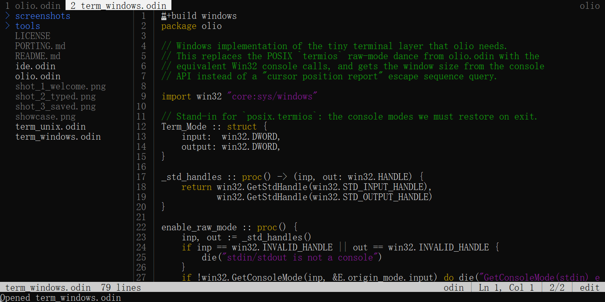

# Olio

A terminal text editor for Odin that grew into a small IDE: a kilo clone at the
core, with a project tree, multiple buffers and an integrated `odin build` whose
diagnostics you can jump to.

Written in Odin. Runs on Windows (Win32 console) and on POSIX terminals
(Linux/macOS/BSD).



## Features

- Odin syntax highlighting, line numbers, control-character display, hard tabs
- Multiple buffers in a tab bar, per-buffer cursor/scroll/dirty state
- Project file tree with expand/collapse (`Ctrl-B`)
- Odin toolchain integration, run on the package of the current buffer:
  - `Ctrl-K` `odin check` — diagnostics only, no codegen (fastest feedback)
  - `Ctrl-R` `odin build` — binary goes to a temp dir, so it never locks `olio.exe`
  - `Ctrl-T` `odin run` — builds and executes, the program's output lands in the panel
  - diagnostics are listed by kind and `Enter` opens the file at `file(line:col)`
- Find (`Ctrl-F`), save (`Ctrl-S`), go to line (`Ctrl-G`), open by path (`Ctrl-O`)
- CRLF and UTF-8 BOM tolerant file loading
- Undo-free, dependency-free, under 2.1k lines of Odin


## Keys

| Key | Action |
| --- | --- |
| `Ctrl-B` | toggle the file tree (focus moves into it; `Esc` returns to the editor) |
| `Ctrl-K` | `odin check` the current buffer's package |
| `Ctrl-R` | `odin build` the current buffer's package |
| `Ctrl-T` | `odin run` the current buffer's package, output in the panel |
| `Ctrl-E` | show/hide the build panel |
| `Ctrl-S` | save the current buffer |
| `Ctrl-O` | open a file by path |
| `Ctrl-N` / `Ctrl-P` | next / previous buffer |
| `Ctrl-W` | close the current buffer |
| `Ctrl-F` | incremental find |
| `Ctrl-G` | go to line |
| `Ctrl-Q` | quit (three presses if the buffer is dirty) |

In the file tree: arrows move, `Enter` opens a file or toggles a directory,
`Right`/`Left` expand/collapse, `r` re-scans. In the build panel: arrows move,
`Enter` jumps to the diagnostic, `c` clears the panel.

### A note on "the current file"

Odin compiles **packages**, not files (`odin build -file` treats one file as a
whole package, which fails as soon as the directory has more than one). So the
tool keys run in the directory of the buffer on screen — i.e. on the package the
current file belongs to. For a scratch program that is alone in its directory
that is the same thing as running that file.

`Ctrl-T` captures the program's stdout/stderr, so programs that read from stdin
(interactive TUIs, prompts) are not usable this way: give the process no input
and it exits immediately.

The cursor position, file type, buffer number and focus are shown in the status
bar; the right side of the tab bar shows the project name or the last build
result.

## Build and run

```powershell
odin build . -out:olio.exe
.\olio.exe                 # empty buffer, file tree rooted at the cwd
.\olio.exe src\main.odin   # open a file, project root becomes its directory
```

On Linux/macOS the same commands work with `olio` as the output name.

Set `OLIO_ODIN` to point at a specific compiler if `odin` is not on `PATH`
(otherwise olio looks for `odin.exe` on `PATH`, then in `%USERPROFILE%\Odin`):

```powershell
$env:OLIO_ODIN = "C:\Users\me\Odin\odin.exe"
```

### Starting from any directory

Put the folder holding `olio.exe` on the **user** `PATH` once:

```powershell
$dir = (Resolve-Path .).Path
[Environment]::SetEnvironmentVariable(
    'Path', [Environment]::GetEnvironmentVariable('Path','User') + ';' + $dir, 'User')
```

Open a new terminal, then:

```powershell
olio                      # cwd becomes the project root
olio .                    # same thing
olio C:\notes\todo.txt    # open any text file, from anywhere
olio ..\other\proj        # open another project
olio brand-new.txt        # does not exist yet: new buffer, Ctrl-S creates it
```

What the argument does:

| Argument | Result |
| --- | --- |
| none | project root = current directory, empty buffer |
| a directory | that directory becomes the project root |
| an existing text file | opened, and the root becomes its directory |
| a path that does not exist | new empty buffer carrying that name (`Ctrl-S` writes it) |
| a binary or >64 MB file | refused with a status message, nothing else changes |

### Desktop launcher (Windows)

`launch-ide.cmd` starts the IDE in a console window with the Odin directory
prepended to `PATH` if the compiler is not there yet:

- double-click it (or a shortcut to it) to open the olio project;
- drag a **file** onto it to open that file;
- drag a **folder** onto it to use that folder as the project root.

`Olio IDE.lnk` on the Desktop points at this script and uses `assets/olio.ico`
as its icon. Recreate the shortcut with:

```powershell
$lnk = Join-Path ([Environment]::GetFolderPath('Desktop')) 'Olio IDE.lnk'
$ws  = New-Object -ComObject WScript.Shell
$sc  = $ws.CreateShortcut($lnk)
$sc.TargetPath       = (Resolve-Path .\launch-ide.cmd).Path
$sc.WorkingDirectory = (Get-Location).Path
$sc.IconLocation     = (Resolve-Path .\assets\olio.ico).Path + ',0'
$sc.Save()
```


## Layout of the code

| File | Contents |
| --- | --- |
| `olio.odin` | editor core: rows, keys, syntax highlighting, find, save/load, main loop |
| `ide.odin` | buffers, file tree, build runner, diagnostics, screen layout, key routing |
| `term_windows.odin` | Win32 console raw mode, window size, resize polling |
| `term_unix.odin` | POSIX `termios` raw mode, window size via cursor-position report |

See [PORTING.md](./PORTING.md) for the platform notes.

## Limitations

- Terminal resize is detected on Windows only; the POSIX path keeps the size
  measured at startup.
- The build is synchronous: the UI waits for `odin build` to finish (it renders a
  "building..." state first).
- No undo, no LSP, no auto-indent. It is a small editor, on purpose.

Inspired by [kilo](https://github.com/antirez/kilo).
