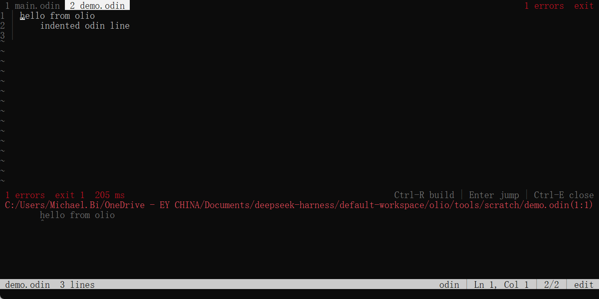

# Olio

A terminal text editor for Odin that grew into a small IDE: a kilo clone at the
core, with a project tree, multiple buffers and an integrated `odin build` whose
diagnostics you can jump to.

Written in Odin. Runs on Windows (Win32 console) and on POSIX terminals
(Linux/macOS/BSD).


## Features

- Odin syntax highlighting, line numbers, control-character display, hard tabs
- Multiple buffers in a tab bar, per-buffer cursor/scroll/dirty state
- Project file tree with expand/collapse (`Ctrl-B`)
- Integrated build (`Ctrl-R`): runs `odin build` on the project root, lists
  diagnostics by kind, `Enter` on a diagnostic opens the file at `file(line:col)`
- Find (`Ctrl-F`), save (`Ctrl-S`), go to line (`Ctrl-G`), open by path (`Ctrl-O`)
- CRLF and UTF-8 BOM tolerant file loading
- Undo-free, dependency-free, under 1.6k lines of Odin



## Keys

| Key | Action |
| --- | --- |
| `Ctrl-B` | toggle the file tree (focus moves into it; `Esc` returns to the editor) |
| `Ctrl-R` | build the project (`odin build <root>`, output goes to a temp dir) |
| `Ctrl-E` | show/hide the build panel |
| `Ctrl-S` | save the current buffer |
| `Ctrl-O` | open a file by path |
| `Ctrl-N` / `Ctrl-P` | next / previous buffer |
| `Ctrl-W` | close the current buffer |
| `Ctrl-F` | incremental find |
| `Ctrl-G` | go to line |
| `Ctrl-Q` | quit (three presses if the buffer is dirty) |

In the file tree: arrows move, `Enter` opens a file or toggles a directory,
`Right`/`Left` expand/collapse, `r` re-scans. In the build panel: arrows move,
`Enter` jumps to the diagnostic, `c` clears the panel.

The cursor position, file type, buffer number and focus are shown in the status
bar; the right side of the tab bar shows the project name or the last build
result.

## Build and run

```powershell
odin build . -out:olio.exe
.\olio.exe                 # empty buffer, file tree rooted at the cwd
.\olio.exe src\main.odin   # open a file, project root becomes its directory
```

On Linux/macOS the same commands work with `olio` as the output name.

Set `OLIO_ODIN` to point at a specific compiler if `odin` is not on `PATH`:

```powershell
$env:OLIO_ODIN = "C:\Users\me\Odin\odin.exe"
```

## Layout of the code

| File | Contents |
| --- | --- |
| `olio.odin` | editor core: rows, keys, syntax highlighting, find, save/load, main loop |
| `ide.odin` | buffers, file tree, build runner, diagnostics, screen layout, key routing |
| `term_windows.odin` | Win32 console raw mode, window size, resize polling |
| `term_unix.odin` | POSIX `termios` raw mode, window size via cursor-position report |

See [PORTING.md](./PORTING.md) for the platform notes.

## Limitations

- Terminal resize is detected on Windows only; the POSIX path keeps the size
  measured at startup.
- The build is synchronous: the UI waits for `odin build` to finish (it renders a
  "building..." state first).
- No undo, no LSP, no auto-indent. It is a small editor, on purpose.

Inspired by [kilo](https://github.com/antirez/kilo).
