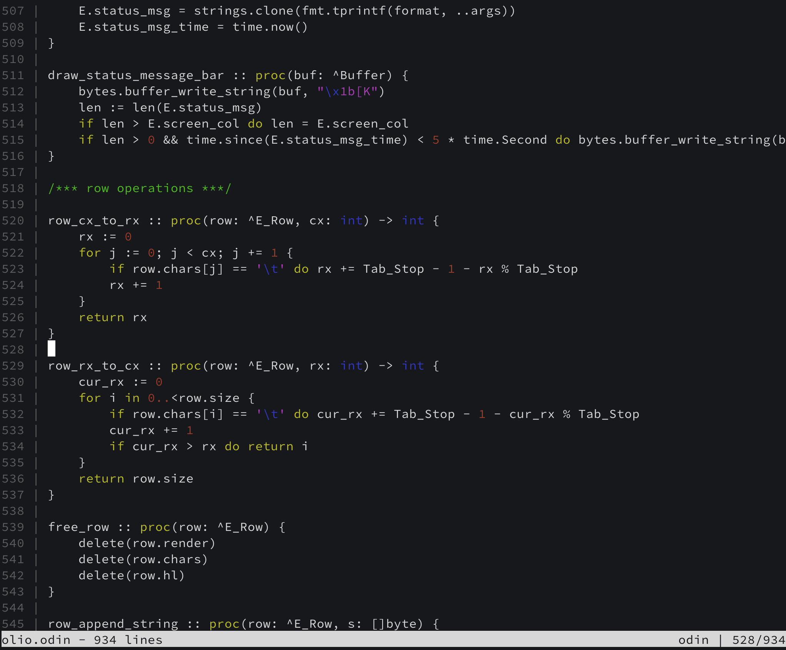

# Olio

A terminal based text editor in less than 900 lines of code (according to the cloc) written in odin.  
This project is inspired by [kilo](https://github.com/antirez/kilo).

## Additional features
- Support Odin syntax highlighting
- Display line numbers

