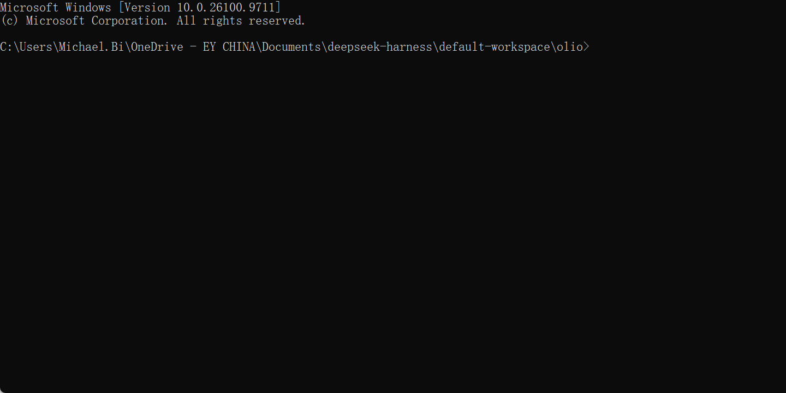

# Olio

A terminal text editor for Odin that grew into a small IDE: a kilo clone at the
core, with a project tree, multiple buffers and an integrated `odin build` whose
diagnostics you can jump to.

Written in Odin. Runs on Windows (Win32 console) and on POSIX terminals
(Linux/macOS/BSD).


## Features

- Odin syntax highlighting, plus keyword highlighting for C/C++, Python, shell, JSON, HTML and Makefiles, and a small Markdown pass (headings, fences, inline code). Hard tabs, line numbers, control-character display
- UTF-8 editing: the cursor, Backspace and Delete step by codepoint. Display columns count one cell per rune (CJK stays width 1)
- Undo and redo (`Ctrl-Z` / `Ctrl-Y`), up to 200 steps. Typed ASCII is one step per character; a multi-byte rune is one step. Replace-all is a single step
- Selection with Shift-arrows, `Ctrl-A` and `Ctrl-L`. Copy, cut and paste (`Ctrl-C` / `Ctrl-X` / `Ctrl-V`). With no selection, cut and copy are linewise
- On Windows, copy and paste use the system clipboard (`CF_UNICODETEXT`). On Linux and macOS, copy emits OSC 52 and paste uses olio's own clipboard; a terminal paste (often `Ctrl-Shift-V`) is inserted via bracketed paste
- Enter keeps the current line's indent. Home toggles column 0 and the first non-blank. `Ctrl-Left` / `Ctrl-Right` move by word. `Ctrl-Home` / `Ctrl-End` jump to the buffer edges. `Ctrl-D` duplicates the line
- Multiple buffers in a tab bar, per-buffer cursor, scroll, selection, undo and dirty state
- Project file tree with expand/collapse (`Ctrl-B`)
- Odin toolchain integration, run on the package of the current buffer:
  - `Ctrl-K` `odin check` — diagnostics only, no codegen (fastest feedback)
  - `Ctrl-R` `odin build` — binary goes to a temp dir, so it never locks `olio.exe`
  - `Ctrl-T` `odin run` — builds and executes, the program's output lands in the panel
  - diagnostics are listed by kind and `Enter` opens the file at `file(line:col)`
- Find (`Ctrl-F`, case-insensitive by default; `Alt-C` toggles case; `F3` / `Shift-F3` repeat), replace all (`F2`, one undo step), save (`Ctrl-S`), go to line (`Ctrl-G`), open by path (`Ctrl-O`)
- Recent files (`Alt-R`): `%APPDATA%\olio\recent` on Windows, `~/.config/olio/recent` elsewhere
- CRLF is preserved. A new empty file on Windows is saved as CRLF; elsewhere as LF. A leading UTF-8 BOM is skipped on load
- `F1` lists the keys. `F5` remeasures the window


## Keys

| Key | Action |
| --- | --- |
| `Ctrl-B` | toggle the file tree (focus moves into it; `Esc` returns to the editor) |
| `Ctrl-K` | `odin check` the current buffer's package |
| `Ctrl-R` | `odin build` the current buffer's package |
| `Ctrl-T` | `odin run` the current buffer's package, output in the panel |
| `Ctrl-E` | show/hide the build panel |
| `Ctrl-S` | save the current buffer |
| `Ctrl-O` | open a file by path |
| `Ctrl-N` / `Ctrl-P` | next / previous buffer |
| `Ctrl-W` | close the current buffer |
| `Ctrl-F` | find (case-insensitive until `Alt-C`; arrows jump while the prompt is open) |
| `F3` / `Shift-F3` | next / previous match of the last query |
| `F2` | replace every match (one undo step; empty replacement deletes) |
| `Alt-C` | toggle case-sensitive search |
| `Ctrl-Z` / `Ctrl-Y` | undo / redo |
| `Ctrl-A` / `Ctrl-L` | select all / select line |
| Shift-arrows | extend the selection |
| `Ctrl-C` / `Ctrl-X` / `Ctrl-V` | copy / cut / paste |
| `Ctrl-D` | duplicate the current line |
| `Ctrl-Left` / `Ctrl-Right` | previous / next word |
| `Home` | toggle column 0 and the first non-blank column |
| `Ctrl-Home` / `Ctrl-End` | start / end of the buffer |
| `Alt-R` | recent files |
| `F1` | key list |
| `F5` | remeasure the window |
| `Ctrl-G` | go to line |
| `Ctrl-Q` | quit (three presses if the buffer is dirty) |

In the file tree: arrows move, `Enter` opens a file or toggles a directory,
`Right`/`Left` expand/collapse, `r` re-scans. In the build panel: arrows move,
`Enter` jumps to the diagnostic, `c` clears the panel.

### A note on "the current file"

Odin compiles **packages**, not files (`odin build -file` treats one file as a
whole package, which fails as soon as the directory has more than one). So the
tool keys run in the directory of the buffer on screen — i.e. on the package the
current file belongs to. For a scratch program that is alone in its directory
that is the same thing as running that file.

`Ctrl-T` captures the program's stdout/stderr, so programs that read from stdin
(interactive TUIs, prompts) are not usable this way: give the process no input
and it exits immediately.

The cursor position, file type, buffer number and focus are shown in the status
bar; the right side of the tab bar shows the project name or the last build
result.

## Build and run

```powershell
odin check . -vet -target:windows_amd64
odin build . -vet -out:olio.exe
.\olio.exe                 # empty buffer, file tree rooted at the cwd
.\olio.exe src\main.odin   # open a file, project root becomes its directory
```

`odin check` type-checks the Windows sources (`term_windows.odin`) without producing a binary. `odin build` on Windows produces `olio.exe`. On Linux/macOS the same check is `odin check . -vet` and the build is `odin build . -vet -out:olio`.

These were verified with Odin `dev-2026-11-nightly` (`dev-2026-11a`, commit `9a69916`).

Set `OLIO_ODIN` to point at a specific compiler if `odin` is not on `PATH`
(otherwise olio looks for `odin.exe` on `PATH`, then in `%USERPROFILE%\Odin`):

```powershell
$env:OLIO_ODIN = "C:\Users\me\Odin\odin.exe"
```

### Starting from any directory

Put the folder holding `olio.exe` on the **user** `PATH` once:

```powershell
$dir = (Resolve-Path .).Path
[Environment]::SetEnvironmentVariable(
    'Path', [Environment]::GetEnvironmentVariable('Path','User') + ';' + $dir, 'User')
```

Open a new terminal, then:

```powershell
olio                      # cwd becomes the project root
olio .                    # same thing
olio C:\notes\todo.txt    # open any text file, from anywhere
olio ..\other\proj        # open another project
olio brand-new.txt        # does not exist yet: new buffer, Ctrl-S creates it
```

What the argument does:

| Argument | Result |
| --- | --- |
| none | project root = current directory, empty buffer |
| a directory | that directory becomes the project root |
| an existing text file | opened, and the root becomes its directory |
| a path that does not exist | new empty buffer carrying that name (`Ctrl-S` writes it) |
| a binary or >64 MB file | refused with a status message, nothing else changes |

### Desktop launcher (Windows)

`launch-ide.cmd` starts the IDE in a console window with the Odin directory
prepended to `PATH` if the compiler is not there yet:

- double-click it (or a shortcut to it) to open the olio project;
- drag a **file** onto it to open that file;
- drag a **folder** onto it to use that folder as the project root.

### Managed machines (application control)

On a machine with an endpoint agent such as BeyondTrust / Avecto Privilege Guard
or Zscaler, an executable the agent does not recognise is launched with a
**restricted token**: it runs, but every write to the user profile fails with
`Permission_Denied` / `CreateFileW failed (5)` — even in `%TEMP%`, and even
though PowerShell or Notepad can write the same folder. A GUI build does not
change this: the decision is made per executable at process creation, not by
console vs window subsystem.

Measured on such a machine (agent trusts the developer folder
`%USERPROFILE%\.zcode\workspace`):

| Where `olio.exe` / a test binary lives | token | can write |
| --- | --- | --- |
| ordinary folder (repo, `%TEMP%`, Downloads) | `restricted SIDs = 4` | no |
| `%USERPROFILE%\.zcode\workspace\...` | `restricted SIDs = 0` | yes |
| anywhere, launched elevated | full | yes |

``launch-ide.cmd` just runs `olio.exe` from its own directory, so on this machine
the project itself lives in the trusted folder
(`%USERPROFILE%\.zcode\workspace\olio`): exactly one copy of the binary and no
install step.

```powershell
.\build.cmd          # odin build . -out:olio.exe  (in place)
```

The Desktop shortcut and the `olio` command on `PATH` both point at that folder,
so saving needs no elevation.
The clean long-term fix is to have IT allow-list `olio.exe`, or to sign it with
the company code-signing certificate.

`Olio IDE.lnk` on the Desktop points at this script and uses `assets/olio.ico`
as its icon. Recreate the shortcut with:
```powershell
$lnk = Join-Path ([Environment]::GetFolderPath('Desktop')) 'Olio IDE.lnk'
$ws  = New-Object -ComObject WScript.Shell
$sc  = $ws.CreateShortcut($lnk)
$sc.TargetPath       = (Resolve-Path .\launch-ide.cmd).Path
$sc.WorkingDirectory = (Get-Location).Path
$sc.IconLocation     = (Resolve-Path .\assets\olio.ico).Path + ',0'
$sc.Save()
```



## Layout of the code

| File | Contents |
| --- | --- |
| `olio.odin` | editor core: rows, keys, syntax highlighting, save/load, main loop |
| `edit.odin` | UTF-8 motion, undo/redo, selection, find/replace, indent |
| `edit_test.odin` | tests for those operations (`odin test . -vet`) |
| `ide.odin` | buffers, file tree, build runner, diagnostics, screen layout, key routing, help, recent files |
| `term_windows.odin` | Win32 console raw mode, resize polling, system clipboard |
| `term_unix.odin` | POSIX `termios` raw mode, `ioctl` window size, OSC 52 copy |

See [PORTING.md](./PORTING.md) for the platform notes.

## When a save fails

`Ctrl-S` reports the full path plus the reason, for example:

```
Can't save notes.txt: Permission_Denied (read-only, open in another program, or a protected folder)
Can't save: no such directory C:\Users\me\notes\drafts
Can't save: C:\Users\me\notes is a directory
```

`Permission_Denied` on Windows is `ERROR_ACCESS_DENIED` **or**
`ERROR_SHARING_VIOLATION`, so it means one of:

- the file exists and is read-only (`attrib -r` clears that);
- another program holds it open without sharing;
- the folder is protected (Windows Controlled Folder Access, Program Files,
  `C:\Windows\...`, a network share without write rights, a OneDrive folder that
  is still syncing or cloud-only);
- the name contains characters Windows rejects (`"`, `:`, `|`, ...).

`tools/savetest` is a small package that prints the error for each of these
cases, useful to tell a real permission problem from a sandbox/policy one:

```powershell
odin run tools/savetest
```

## Limitations
- The build is synchronous: the UI waits for `odin build` to finish (it renders a
  "building..." state first).
- No LSP, no mouse, no split panes, no soft wrap. CJK characters are one column wide.
- Python triple-quotes are treated as a kilo-style multi-line comment, not as a
  string that can end on the same line.
- Search folds ASCII case only.
- On Linux and macOS, `Ctrl-V` cannot read the desktop clipboard (there is no
  portable read). Copy still sends OSC 52 for terminals that honour it, and a
  terminal paste is inserted through bracketed paste.

## Credit

The editing ideas added in 0.5 — per-codepoint cursor motion, undo/redo,
selection, word motion, smart indent, case-insensitive find with replace-all,
recent files, and bracketed paste — follow
[JOHN](https://github.com/joaocarvalhoopen/John_simple_text_editor_in_Odin)
by João Carvalho, which is distributed as MIT ("MIT Open Source License" in
that repository's README and file headers; it does not ship a separate
`LICENSE` file). They were reimplemented against olio's kilo-style rows.
John's sources are not included here.

Left in JOHN, and not brought over: recursive splits and mouse selection
(they would replace olio's layout, and Windows mouse input is a different
API), the menu bar, the `~/.config/john/keys.conf` keymap (several of those
chords are already olio's `odin check` / build / run keys), code completion,
the double-buffered cell renderer, soft wrap, and the long per-language
lexers.

Inspired by [kilo](https://github.com/antirez/kilo).
